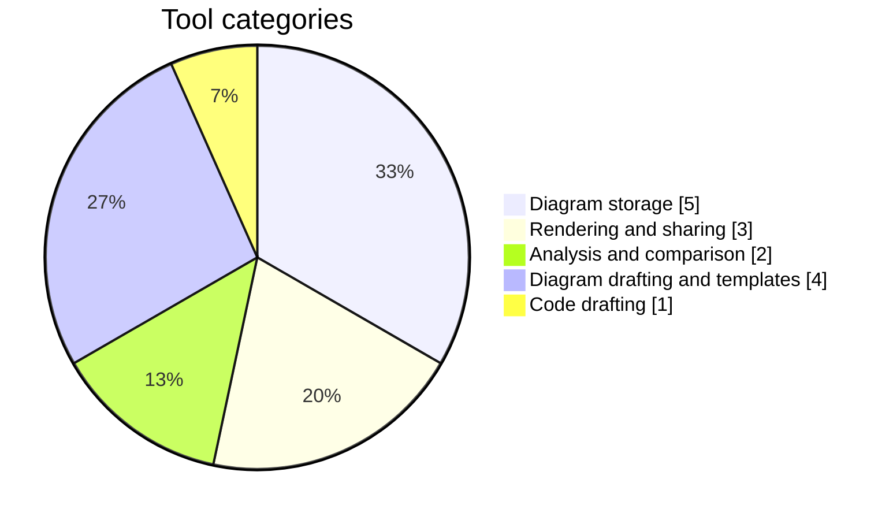
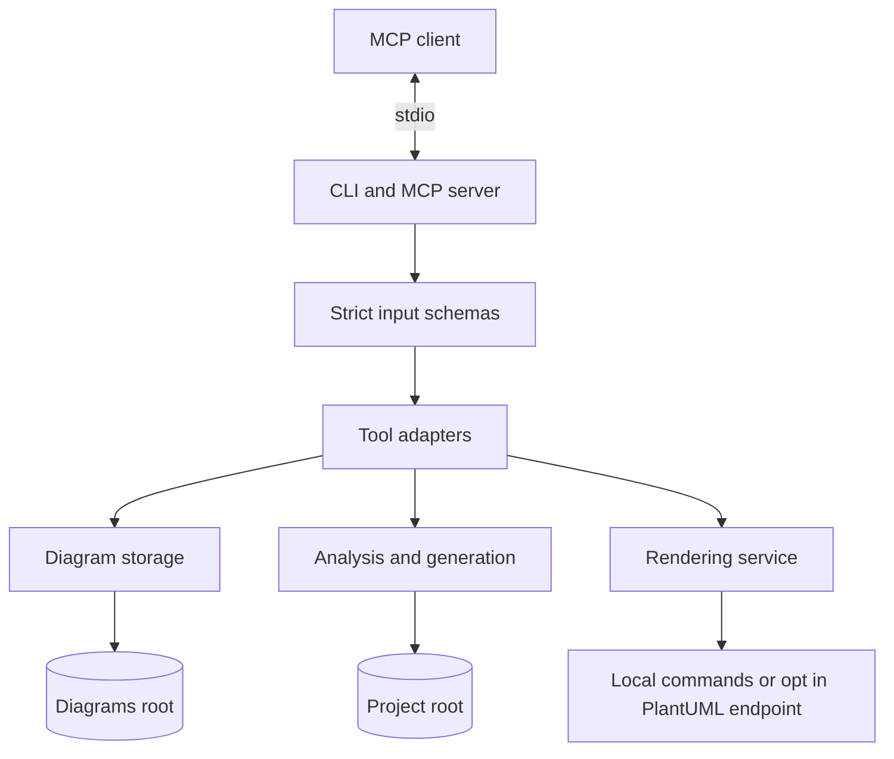
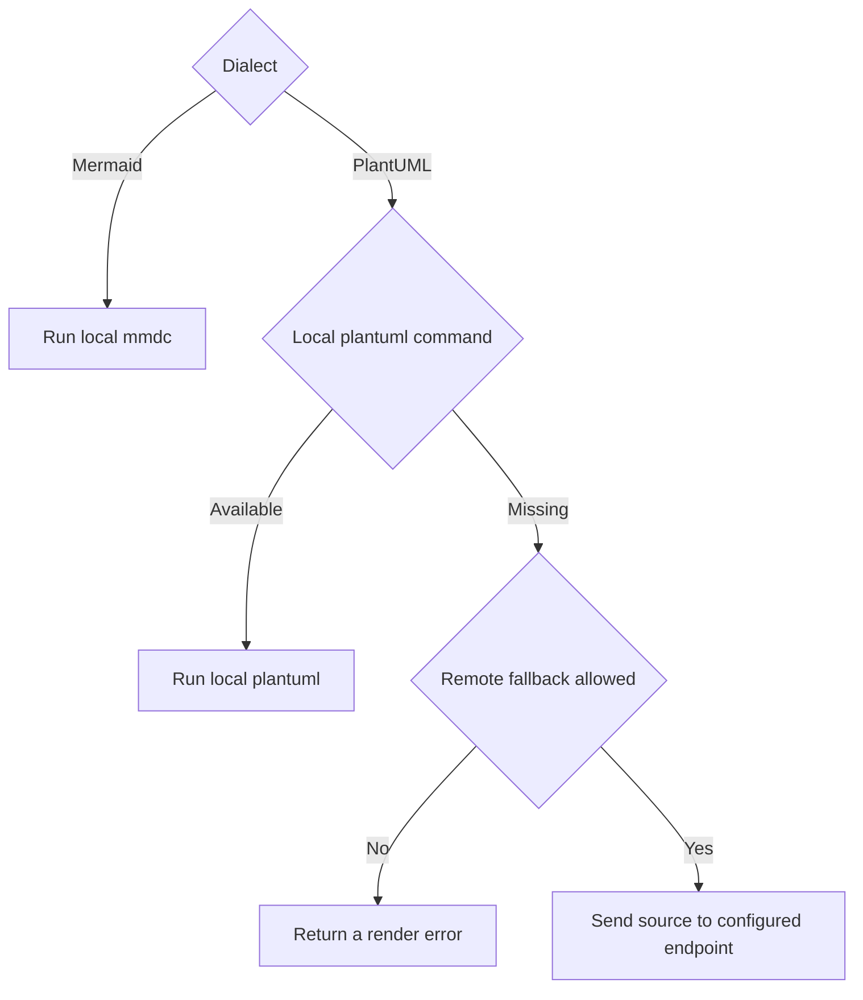
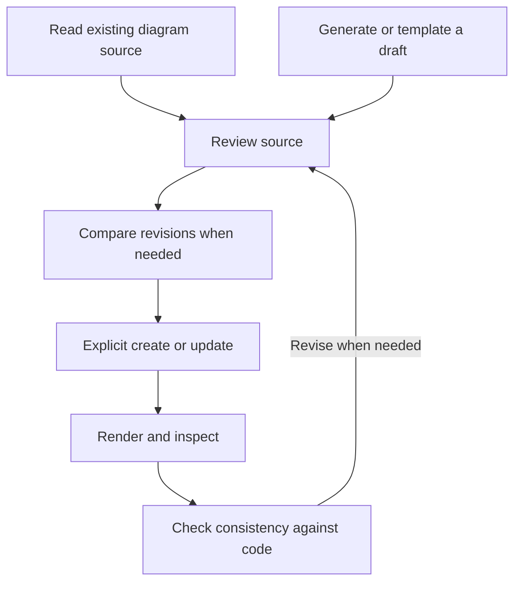

DIAGRAMS MCP SERVER
===================

Engineering documentation for a local first MCP server that keeps PlantUML
and Mermaid diagrams beside the code they describe

The server gives an MCP client a controlled interface for reading and
maintaining diagram source and for comparing that source with a codebase
It also produces reviewable diagram drafts and rendered exports
Source files remain the editable record of the architecture

PROJECT STATUS
==============

The project is a technical preview
This document describes version zero nine zero with fifteen tools

Version zero nine zero adds diagrams_save_export and diagrams_scaffold
The scaffold member and field type and named relationship modes described
below are included in that version
Check the installed package version when comparing its tool surface with main

Main also includes an unreleased extension for nullable scaffold field types
The nullable syntax described below is not included in version zero nine zero

The chart groups the fifteen tools by their primary purpose
It describes the tool surface rather than project completion

The package declares Node 18 or newer as its runtime requirement
Continuous integration checks Node 20 and Node 22 on Ubuntu and Windows
The TypeScript compiler is a development dependency rather than a required
production dependency

SYSTEM MODEL
============

An MCP client starts the server as a child process and exchanges protocol
messages over standard input and standard output
Startup diagnostics use standard error so they do not occupy the protocol
stream

The project root defines the code analysis boundary
The diagrams root defines the diagram storage boundary
Custom template definitions are read separately beneath the project root
These roots are resolved once when the server starts
Diagram paths supplied to tools are relative to the diagrams root
Code scopes supplied to analysis tools are relative to the project root

The architecture separates protocol handling from services and external
resources
Responses return through the tool adapter to the connected client

Tool adapters own protocol contracts and response formatting
Services own filesystem operations and analysis and source generation
Renderers invoke external command line tools through a separate command
boundary
Expected domain failures become tool errors
Unexpected failures return a generic error and are logged through the
shared error handling layer

INSTALLATION AND CLIENT CONNECTION
==================================

Install the published server with npm:

    npm install -g diagrams-mcp-server

Run guided setup from the project directory:

    diagrams-mcp-server setup

The setup workflow supports Claude Code and Codex and Cursor and VS Code
and OpenCode and Antigravity
It checks the selected client and project path before applying its supported
configuration method
Some clients require a manual command that setup prints for you

For a noninteractive Codex setup:

    diagrams-mcp-server setup --client codex --yes

For a Cursor configuration pinned to the current project:

    diagrams-mcp-server setup --client cursor --scope project --yes

Global scope is the default and leaves PROJECT_ROOT out of the server entry
The server then uses the working directory supplied by the launching client
Project scope places PROJECT_ROOT in the configuration so the server stays
attached to one codebase
An explicit --project-root also pins the root
VS Code setup writes project configuration

After setup reload the client configuration and inspect its available tools
Use diagrams_list to confirm the diagrams root before creating files
An empty inventory is valid for a new project

Other stdio MCP clients can launch diagrams-mcp-server directly or use npx
with arguments -y diagrams-mcp-server
The server command accepts no tool requests through ordinary CLI arguments
Tool calls travel through the MCP connection

For available startup and setup options:

    diagrams-mcp-server --help
    diagrams-mcp-server setup --help

CONFIGURATION AND RENDERING
===========================

PROJECT_ROOT selects the codebase used for analysis
Its default is the server process working directory

DIAGRAMS_DIR selects the diagrams root
Its default is the diagrams directory beneath PROJECT_ROOT
A relative value is resolved beneath PROJECT_ROOT
An absolute value selects a separate storage location
Restart the server after changing either root

Rendering requires a working external renderer on PATH
PlantUML uses the plantuml command
Mermaid uses the mmdc command from the Mermaid CLI package
The server package does not install either renderer for you
External renderer packages have their own runtime requirements

To install the Mermaid command:

    npm install -g @mermaid-js/mermaid-cli

PlantUML rendering prefers the local command
When that command is missing remote fallback remains disabled unless
ALLOW_REMOTE_PLANTUML is exactly true
DISABLE_REMOTE_PLANTUML set to exactly true overrides that permission
PLANTUML_SERVER_URL selects the remote endpoint when fallback is enabled
The default endpoint is the public PlantUML rendering service

Remote fallback sends diagram source to the configured server
Mermaid rendering always uses the local command
A local renderer execution failure is an error rather than a reason to
retry remotely
Rendering uses temporary files that are cleaned up after the operation

Renderer selection follows the decision chart below
Remote permission means ALLOW_REMOTE_PLANTUML is exactly true while
DISABLE_REMOTE_PLANTUML is not true
Only a missing local PlantUML command reaches that decision

WORKING WITH DIAGRAMS
=====================

Start by discovering existing diagrams with diagrams_list
Read the selected source with diagrams_get before proposing a change
Use diagrams_diff to compare the existing source with a proposed revision
Then apply the reviewed revision through diagrams_update
Use diagrams_create for a new diagram and diagrams_delete for explicit
removal

Create refuses an existing target
Update operates on an existing diagram
Storage validates recognized diagram extensions and source structure
These checks establish basic dialect shape rather than full language
correctness
Use rendering and human review to inspect the resulting diagram

For a new architecture draft use diagrams_generate on a narrow code scope
For a call flow draft use diagrams_generate_sequence
For a blank design use diagrams_template
These tools return source for review without saving a diagram
Pass reviewed source to diagrams_create when you decide to persist it

Run diagrams_check_consistency after a code change to inspect declaration
evidence for diagram entities
Treat unmatched names as review prompts
An unmatched name can reflect unsupported syntax or incomplete scanning
rather than an architectural defect

This workflow connects the tools through explicit review steps
The arrows describe a suggested user workflow rather than an automatic
pipeline
Generation and comparison do not save files on your behalf

TOOL CONTRACTS
==============

Inventory and source access
---------------------------

diagrams_list supports type_filter and zero based offset pagination
An explicit limit accepts 1 through 500
Omitting limit returns all remaining matches
The response distinguishes the page count from the total and reports
has_more so callers can continue without guessing

diagrams_get returns complete source unless max_chars requests a window
An explicit window accepts 1 through 100000 UTF-16 code units
The response reports offset and returned_chars and total_chars together
with is_partial and has_more
An offset beyond the source is an error

diagrams_create and diagrams_update and diagrams_delete are the explicit
diagram mutation tools
All fifteen tools in the current checkout reject unknown input arguments
Clients should use the tool schemas exposed by MCP discovery as the exact
argument reference

Analysis and comparison
-----------------------

diagrams_check_consistency compares extracted diagram names with source
declaration evidence and reports matched files and analyzer tiers
Its extractors include language specific declaration patterns and a generic
whole word fallback
The optional TypeScript compiler improves selected analysis paths
The result remains heuristic and does not establish runtime correctness

diagrams_diff accepts two sides
Each side must provide exactly one stored path or inline source
Inline source must identify a recognized diagram dialect
Input shape is checked before either stored side is read

The default comparison reports added and removed names with heuristic
rename pairing
It does not compare layout or member signatures or resolved types
Setting compare_call_order to true additionally compares recognized call
names in source order while preserving repetitions
That mode accepts at most 10000 recognized calls per side and fails above
the ceiling rather than returning a partial comparison
It does not establish runtime execution order

Diagram generation and templates
--------------------------------

diagrams_generate returns a class diagram draft from source declarations
It can include evidenced TypeScript inheritance and implementation edges
when the optional compiler is available
Without that support it returns declaration based output with an explicit
note about unavailable relations
It does not perform full type resolution

diagrams_generate_sequence returns a static call flow draft
It reports unresolved callees rather than inventing participants
On main an unreleased correction keeps each sender tied to the file containing
the call site even when another file declares the same caller name
Callee lookup still uses the first case insensitive declaring participant
Calls inside callbacks are conservatively treated as deferred and excluded
from the ordered messages
This policy is not a claim that every callback executes asynchronously
include_call_parentheses changes message labels only

diagrams_template emits class or sequence or c4_context starter source in
puml or mermaid format
It accepts 1 through 20 unique ASCII identifier names of at most 60
characters each and an optional nonblank title of at most 200 characters

For project templates use template set to custom with a custom_template
identifier
Definitions are JSON files in the project root hidden directory named
diagrams-templates with a leading dot
Each filename is the identifier followed by the JSON extension
The identifier accepts ASCII letters and digits and underscores and hyphens
with a length from 1 through 64

A definition supports optional puml and mermaid sections
Each supplied section requires source and entity strings
The supported placeholders are {{title}} and {{entities}} and {{name}}
Expansion is a single pass and does not evaluate code
Definitions must be regular files rather than symbolic links
The read ceiling is 65536 bytes and the expanded source ceiling is 1000000
UTF-16 code units

diagrams_list_templates discovers built in kinds and custom filename
candidates without reading custom definition contents
Discovery examines at most 1000 directory entries plus a lookahead entry
Custom content is validated when diagrams_template instantiates it
Discovery does not create a missing template directory

Rendering and sharing
---------------------

diagrams_render returns SVG or PNG through the configured renderer
diagrams_export returns a standalone HTML document without persisting the
export target
Both operations share the renderer selection policy described above

HTML exports embed SVG as a base64 image rather than inline SVG markup
This isolates the image from the surrounding document but is not an SVG
sanitizer
Text within the rendered image is not selectable
A restrictive content security policy limits the wrapper document

include_source defaults to true and embeds the escaped source in a
collapsible section
Setting it to false omits the source section entirely
The finished HTML document must fit within 5000000 UTF-8 bytes
Oversized exports fail instead of returning a partial document

diagrams_save_export saves the same HTML bundle beneath
the diagrams root through an explicit output_path
The target must use the HTML extension and must not already exist
The size check runs before output directories or the output file are created
The response contains acknowledgement and metadata rather than the HTML
Saved HTML files do not become diagrams in the inventory or CRUD tools

TypeScript scaffolding from diagrams
------------------------------------

diagrams_scaffold returns TypeScript source for review
It reads one stored diagram and does not save or execute the proposed code
The default output consists of empty exported classes derived from heuristic
name candidates
Invalid names and reserved names are skipped and reported
An empty candidate set produces empty source

include_members enables a limited parser for plain top level multiline class
blocks
It emits fields as unknown and methods as throwing stubs
Arguments and implementation behavior are not recovered

include_types implies include_members
It preserves only string or number or boolean or bigint or an exactly
emitted class name with an optional single array suffix
On main an unreleased extension also accepts exactly one null arm on either
side of that type and emits the type followed by | null
For example a field labeled string | null remains nullable in the draft
Nullable labels require colon field notation and fit within 69 characters
Whitespace around the separator counts toward that limit
Other unions and bare null remain unsupported
Unsupported field labels remain unknown
Accepted fields use definite assignment without supplying runtime values

include_relations implies both earlier modes
It accepts labeled --> associations between explicitly declared plain
classes that are also emitted
The role label becomes a proposed field
Supported target multiplicity can produce an array field
Existing body members win over relation fields and accepted names keep
their first occurrence
The result does not recover ownership or enforce cardinality

Scaffolding defaults to 30 classes and permits at most 60
Each class accepts at most 30 emitted members
Relation mode appends at most 300 relationship fields across the result
Metadata distinguishes skipped candidates from cap related omissions
Source above 1000000 UTF-8 bytes is refused after the stored file is read
This ceiling limits processed input rather than the memory needed to read
the original file

OPERATIONAL LIMITS AND FAILURE RECOVERY
======================================

Consistency and code generation scans examine at most 5000 source files
Directory traversal skips hidden directories and known dependency and build
directories such as node_modules and dist and build and out and target
Only files with recognized code extensions are collected
An unmatched name in an excluded file is outside that scan result
Files above 1000000 bytes are skipped
The scanners limit concurrent file reads to 32
Consistency evidence retains at most 10 matched file references per entity
while reporting the full match count

Class generation defaults to 30 entities with a ceiling of 60
It emits at most 60 relations and omits edges whose endpoints were capped
Sequence generation defaults to 8 participants and 20 messages
Its ceilings are 20 participants and 50 messages
Inspect truncated and scan_warning and the tool specific cap metadata
before treating any result as complete

Local renderer commands have a default timeout of 20000 milliseconds
Captured renderer streams are bounded at 1000000 characters each
Since version zero nine zero local SVG and PNG image files are limited
to 5000000 bytes before base64 encoding or HTML bundling
Oversized image files are refused and the temporary render directory is removed
Split or simplify the diagram before trying again
Remote PlantUML requests also have a 20000 millisecond timeout and a
5000000 byte response ceiling
Since version zero nine zero the timeout covers headers and the full
body download and the byte ceiling is enforced as decoded chunks arrive
Oversized or failed downloads are stopped and unused HTTP error bodies
are discarded
These bounds do not turn external renderers into an application sandbox

Tool execution failures are marked with isError set to true
Schema rejection can occur before the handler runs
A missing diagram should lead to a fresh inventory check
An existing create target requires a new path or an intentional update
An existing export target requires a different output path or explicit
removal outside the export tool
A missing renderer requires installing the command and checking PATH in
the environment that launches the MCP client
A capped scan should lead to a narrower scope before drawing conclusions

The storage and scope services reject paths that escape their configured
roots and apply symbolic link checks at filesystem boundaries
The server still runs with the operating system permissions of its process
Treat diagram source and external renderer configuration as trusted inputs
appropriate to that execution environment

SOURCE ORGANIZATION AND DEVELOPMENT
===================================

The src directory contains runtime source and colocated tests
The tools directory beneath src holds one adapter per tool
The services directory beneath src holds storage and analysis and rendering
and export and scaffold modules
The setup directory beneath src owns client configuration workflows
The integration directory beneath src exercises MCP transport contracts

The scripts directory owns clean builds and compiled test discovery
The dist directory is generated build output
The docs directory holds detailed architecture and project handoff records
The architecture document describes module ownership and request paths
The roadmap document records completed milestones and future candidates
The release checklist records package verification and publication steps
CONTRIBUTING describes the contribution workflow
RELEASE_NOTES records versioned changes
The cleanup handoff and next features documents preserve historical context
and should be read with their recorded scope and date

To work on the current source checkout run these commands from the repository
root in order:

    npm ci
    npm run lint
    npm run format:check
    npm run build
    npm test

Tests run from compiled output so build before running them
The build removes stale output before compiling
For a local MCP client configure node as the server command and supply the
absolute path to the compiled index JavaScript file under dist as its argument
Set PROJECT_ROOT to the codebase that this local server should analyze
This local entry exercises the current source checkout
The published setup command otherwise installs the published package through
npx for its generated server entry

Running npm ci in the checkout also supplies the development TypeScript
compiler for compiler backed analysis
Published installs normally use the fallback extractors
Installing TypeScript only in the analyzed project does not guarantee that
the server package can resolve it

Continuous integration runs lint and formatting checks and a build and an
entry point help check before the test suite
Renderer behavior is covered through controlled dependencies without requiring
global renderer installations or network rendering in the test jobs
External renderer installation still needs validation in the intended runtime
environment

When extending the project keep tool schemas and response metadata explicit
Place reusable behavior in the owning service and preserve filesystem scope
checks at every new storage boundary
Cover observable behavior through focused tests and update the relevant
engineering documentation in the same change

LICENSE
--------

Released under the MIT license
See LICENSE for the full terms
